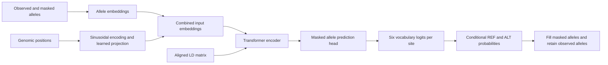

# GTFound-Base

**LD-aware masked haplotype modeling for biallelic genotype imputation.**

GTFound-Base learns to recover missing haplotype alleles from observed alleles, genomic coordinates, and linkage disequilibrium (LD). Its Transformer encoder uses LD as an additive attention bias, allowing each target site to combine sequence context with statistical relationships among variants.

This is the **reference-free model branch** of [GTFound](https://github.com/chen-bioinfo/GTFound): it does not retrieve or cross-attend to reference haplotypes during the model forward pass. The workflow still requires a precomputed LD matrix, which may be estimated from an external reference panel.

The public implementation supports training from scratch, resuming training at epoch boundaries, and imputing aligned tensor windows on CPU or a single CUDA device. A self-contained synthetic example demonstrates the complete training-to-inference workflow.

> Each sequence position represents one biallelic panel variant, not one nucleotide. Model inputs are phased haplotype alleles, not unphased genotype dosages. This directory currently provides source code and configuration; it does not include a pretrained Base checkpoint or human genotype data.

## Contents

- [GTFound-Base and GTFound-Ref](#gtfound-base-and-gtfound-ref)
- [Model overview](#model-overview)
- [Installation](#installation)
- [Quick start](#quick-start)
- [Preparing your data](#preparing-your-data)
- [Training a model](#training-a-model)
- [Resuming training](#resuming-training)
- [Running imputation](#running-imputation)
- [Python interface](#python-interface)
- [Architecture configuration](#architecture-configuration)
- [Checkpoint compatibility](#checkpoint-compatibility)
- [Evaluation and reproducibility](#evaluation-and-reproducibility)
- [Repository layout](#repository-layout)
- [Troubleshooting](#troubleshooting)
- [Development](#development)

## GTFound-Base and GTFound-Ref

Both branches predict REF/ALT alleles at masked sites. Their conditioning inputs, weight formats, and public entry points differ.

| Aspect | GTFound-Base | [GTFound-Ref](../GTFound-Ref/) |
| --- | --- | --- |
| Target input | Observed and masked haplotype alleles | Observed and masked haplotype alleles |
| Genomic context | Genomic positions and aligned LD | Genomic positions and aligned LD |
| Reference haplotypes in the forward pass | Not required | Required |
| Attention mechanism | LD-enhanced self-attention | LD-enhanced self-attention and reference cross-attention |
| Public training entry point | `model_train.py` | Not included in the Ref release |
| Public inference entry point | `inference.py` | `gtfound infer` |
| Model artifacts | User-trained or explicitly converted Base checkpoint | Separately downloaded Ref safetensors checkpoint |
| VCF preparation and export | Tensor interface; see integration notes below | Dedicated `prepare-vcf` and `export-vcf` commands |

**Base and Ref checkpoints are not interchangeable.** Use this directory when training or applying a Base model. Use the Ref directory for the released reference-conditioned model and its VCF workflow.

## Model overview



### Genomic input representation

The model embeds the allele token at each site. One-based genomic positions are converted to sinusoidal features, then passed through a learned linear projection and sigmoid activation. The token and position features are added, normalized, and subjected to dropout before entering the encoder.

The default configuration uses 12 encoder layers, 12 attention heads, a hidden dimension of 768, and an intermediate feed-forward dimension of 3,072. The input window limit is 1,024 variant records.

### LD-enhanced self-attention

For each attention head, the implementation adds the aligned LD bias before softmax:

$$
\operatorname{Attention}(Q,K,V,B_{\mathrm{LD}})
=
\operatorname{softmax}\!\left(\frac{QK^{\mathsf T}}{\sqrt{d_k}}+B_{\mathrm{LD}}\right)V.
$$

Here, $B_{\mathrm{LD}}$ follows exactly the same site order as the target window. The public Base scripts read the supplied matrix values; they do not calculate LD, reorder variants, or rescale the bias. The current public workflow uses the custom LD attention implementation. Alternative attention classes retained in the source tree are outside this workflow.

### Training objective and allele probabilities

During training, the trainer randomly selects sites, replaces their input alleles with `[MASK]`, and predicts the original alleles using masked cross-entropy over the six vocabulary logits. Unselected labels are ignored using PAD index 3. The public trainer does not enable the experimental R-squared or KL losses retained in the source modules.

During inference, it computes a conditional softmax over the first two logits:

$$
P(\mathrm{ALT}\mid x)
=
\frac{\exp(z_1)}{\exp(z_0)+\exp(z_1)}.
$$

These are REF/ALT allele probabilities, not calibrated diploid genotype probabilities. Only originally masked sites are replaced in the exported tensor.

## Installation

### Requirements

| Component | Requirement or recommendation |
| --- | --- |
| Python | 3.10 or later |
| PyTorch | 2.0 or later |
| NumPy | 1.23 or later |
| pandas | 1.5 or later; also used by legacy data utilities |
| Operating system | Linux recommended |
| Compute device | CPU or one NVIDIA GPU with a compatible PyTorch installation |
| PLINK | Not needed by the Base tensor training or inference scripts |

GPU memory depends on batch size, window length, model size, and whether gradients are stored. Start with `--batch-size 1` for the default model. This repository does not specify a benchmarked minimum GPU memory or runtime.

### Set up the source repository

```bash
git clone https://github.com/chen-bioinfo/GTFound.git
cd GTFound/GTFound-Base

python -m venv .venv
source .venv/bin/activate
python -m pip install --upgrade pip
python -m pip install -r requirements.txt
```

For CUDA, install a PyTorch build appropriate for your driver using the [official installation instructions](https://pytorch.org/get-started/locally/) before installing the remaining requirements. For an explicitly CPU-only environment, install CPU PyTorch first:

```bash
python -m pip install torch --index-url https://download.pytorch.org/whl/cpu
python -m pip install -r requirements.txt
```

Check the available device and command-line interfaces:

```bash
python -c "import torch; print('PyTorch:', torch.__version__); print('CUDA available:', torch.cuda.is_available())"
python model_train.py --help
python inference.py --help
```

The commands below assume the working directory is `GTFound-Base`. The scripts can also be invoked by absolute path. The default configuration resolves relative to the source files; paths supplied on the command line resolve relative to the current working directory. This release uses source scripts rather than an installed `gtfound-base` console command.

## Quick start

### Run the complete CPU example

```bash
python quick_start.py --output-dir outputs/quick_start
```

This command performs five steps:

1. Generates three complete synthetic haplotype windows with 16 sites each.
2. Creates a small configuration with one layer, four heads, and hidden dimension 24.
3. Trains for one epoch using the CPU.
4. Reloads the saved checkpoint and predicts 12 masked alleles.
5. Checks finite, normalized probabilities and preservation of observed alleles.

The expected output includes:

```text
Saved 3 windows and 12 imputed sites to .../prediction.pt
Smoke test passed: probability shape (3, 16, 2); observed alleles preserved.
Synthetic training does not establish imputation accuracy.
```

The output directory contains:

```text
outputs/quick_start/
├── inputs/
│   ├── config.json
│   ├── train.pt
│   └── input.pt
├── checkpoints/
│   └── epoch_0000.pt
└── prediction.pt
```

The directory must be absent or empty. Use a new path to rerun the example. The small model, synthetic coordinates, and zero LD make this a software smoke test; they are not the recommended scientific settings or a measure of imputation quality.

### Run each stage separately

To inspect the intermediate artifacts:

```bash
python examples/make_synthetic_input.py --output-dir outputs/example_inputs

python model_train.py \
  --input outputs/example_inputs/train.pt \
  --config outputs/example_inputs/config.json \
  --output-dir outputs/example_checkpoints \
  --device cpu --epochs 1 --batch-size 2

python inference.py \
  --input outputs/example_inputs/input.pt \
  --checkpoint outputs/example_checkpoints/epoch_0000.pt \
  --output outputs/example_prediction.pt \
  --device cpu --batch-size 2
```

## Preparing your data

### Biological alignment

Prepare and quality-control the data before creating tensors:

1. Use a consistent genome assembly and coordinate convention across the target alleles and the data used to estimate LD.
2. Normalize variants and align `CHROM/POS/REF/ALT`. Resolve multiallelic records upstream; the public task is biallelic.
3. Phase diploid GT into two haplotype allele sequences. A heterozygous `0|1` contributes allele 0 to one haplotype and allele 1 to the other.
4. Select the variants for each window and use that exact order for tokens, positions, LD rows, and LD columns.
5. Keep training truth complete. Introduce missing sites dynamically during training or explicitly as token 5 for inference.

The Base loader checks shapes, dtypes, allowed tokens, positive sorted coordinates, and finite LD values. It cannot determine whether an assembly label, allele direction, or LD panel is biologically correct.

### Tensor dictionary

Both public scripts load a dictionary saved with `torch.save`:

| Key | Shape | Recommended dtype | Description |
| --- | --- | --- | --- |
| `tokens` | `[N,L]` | `torch.long` | One haplotype window per row. Training: 0/1. Inference: 0/1/5. |
| `positions` | `[L]` or `[N,L]` | `torch.long` | Positive, sorted, one-based genomic positions. `[L]` shares a site grid across rows. |
| `ld_bias` | `[N,L,L]` | `torch.float32` | LD attention bias with both axes aligned to the window's site order. |

`N` and `L` must be positive. The input length must not exceed `config.max_position_embeddings`; all rows in one dictionary have the same length. The loader performs no automatic padding or window construction. A diploid sample requires a row for each haplotype in each genomic window. Additional dictionary keys are ignored.

For example, the following creates an **illustrative synthetic** dictionary:

```python
from pathlib import Path
import torch

output = Path("outputs/format_example.pt")
output.parent.mkdir(parents=True, exist_ok=True)

tokens = torch.tensor([
    [0, 1, 0, 1, 1, 0, 0, 1],
    [1, 0, 1, 0, 0, 1, 1, 0],
], dtype=torch.long)
positions = torch.tensor([100, 120, 145, 180, 210, 250, 300, 340])
ld_bias = torch.zeros(2, 8, 8, dtype=torch.float32)

torch.save({
    "tokens": tokens,
    "positions": positions,
    "ld_bias": ld_bias,
}, output)
```

Use real, aligned LD for scientific experiments. Finite values are required. Normally zero the diagonal to follow the intended preprocessing convention; the Base loader does not alter it. The full tensor dictionary is loaded into host memory. At `L=1024`, each float32 LD matrix occupies 4 MiB, so 1,000 windows require approximately 3.9 GiB for LD alone. Reducing model batch size does not reduce the memory required to hold the loaded input file.

### Vocabulary and missingness

| Index | Token | Role in the public workflow |
| --- | --- | --- |
| 0 | `0` | REF haplotype allele |
| 1 | `1` | ALT haplotype allele |
| 2 | `2` | Retained vocabulary entry; not accepted as a haplotype input |
| 3 | `[PAD]` | Ignored training labels; not accepted as an input padding token |
| 4 | `[UNK]` | Retained vocabulary entry; not accepted as an input allele |
| 5 | `[MASK]` | Missing allele during inference; introduced by the trainer during training |

Do not encode missing alleles as 0: 0 is observed REF. Do not pass genotype dosage 2 as an ALT/ALT genotype; split a phased diploid call into haplotypes first. The public scripts assume the vocabulary order above; editing `vocab.txt` does not redefine their token semantics.

### Reusing prepared Ref windows

Base inference can read the `tokens`, `positions`, and `ld_bias` tensors from a prepared Ref shard; it ignores `references`. This reuses preprocessing artifacts, not Ref model weights.

If you subsequently use Ref's VCF exporter, preserve the original `manifest.json`, `sites.tsv`, `windows.tsv`, source tensors, and shard correspondence. Save Base predictions as `pred_0000.pt` for `input_0000.pt`, and so on. The exporter requires shapes and masks to match the prepared inputs. See the [Ref VCF processing guide](../GTFound-Ref/docs/VCF_PIPELINE.md) for the full preparation and export procedure. Masked Ref inference shards are not complete Base training truth.

## Training a model

### Start a new run

```bash
python model_train.py \
  --input data/train_windows.pt \
  --config bert_1KGPMLM/config.json \
  --output-dir outputs/base_train \
  --device cuda:0 \
  --epochs 20 \
  --batch-size 1 \
  --learning-rate 5e-5 \
  --mask-rate 0.4 \
  --seed 42 \
  --num-workers 0
```

Replace the input path with a prepared tensor dictionary. Use `--device cpu` for CPU training. The output directory must be absent or empty.

### Training arguments

| Argument | Default | Behavior |
| --- | --- | --- |
| `--input` | Required | Complete 0/1 training windows. |
| `--output-dir` | Required | Empty directory for epoch checkpoints. |
| `--config` | `bert_1KGPMLM/config.json` relative to the source | Architecture for a new model. |
| `--resume` | None | Restore a checkpoint written by this trainer. |
| `--device` | `cpu` | `cpu` or `cuda:N`. |
| `--epochs` | `1` | Number of epochs to execute, including additional epochs on resume. |
| `--batch-size` | `1` | Windows per batch. The final partial batch is retained. |
| `--learning-rate` | `5e-5` | Adam learning rate for a new run. |
| `--mask-rate` | `0.4` | Per-site selection probability in `(0,1]`. |
| `--seed` | `42` | PyTorch seed for a new run. |
| `--num-workers` | `0` | DataLoader worker count. |

### Current training behavior

The public trainer shuffles rows each epoch, samples a fresh mask for every batch, and uses full-precision Adam with a constant learning rate. Every selected allele is replaced by token 5. If a row receives no randomly selected sites, its first site is selected so that the row contributes a training target. Unselected labels are 3 and excluded from cross-entropy.

An epoch log reports cross-entropy averaged over selected sites, followed by the checkpoint path. The scripts do not automatically run validation, select a best model, implement early stopping, or schedule the learning rate. Multi-GPU training and mixed precision are not exposed by this entry point. The current recipe is a usable public workflow rather than a claim to reproduce the previous experiment-specific optimization schedule.

### Saved artifacts

A 20-epoch run creates `epoch_0000.pt` through `epoch_0019.pt`. Each checkpoint contains the architecture configuration, model state, Adam state, completed epoch index, average loss, mask rate, and PyTorch random state. CUDA runs also save CUDA generator states. See [checkpoint details](docs/DATA_FORMAT.md#training-checkpoints).

## Resuming training

Resume from the last completed epoch into a **new output directory**:

```bash
python model_train.py \
  --input data/train_windows.pt \
  --resume outputs/base_train/epoch_0019.pt \
  --output-dir outputs/base_resume \
  --device cuda:0 \
  --epochs 5 \
  --batch-size 1 \
  --mask-rate 0.4 \
  --num-workers 0
```

This executes epochs 20 through 24, creating `epoch_0020.pt` through `epoch_0024.pt` in the new directory. It restores model and optimizer state, architecture, and random state. `--config` is ignored when resuming; the optimizer's saved learning rate overrides `--learning-rate`. The mask rate must match the checkpoint.

For reproducibility, keep the input file, batch size, device setup, worker count, and software environment unchanged. The small CPU regression test checks that one epoch followed by one resumed epoch matches a two-epoch uninterrupted run. This does not imply exact cross-device or cross-version reproducibility. Mid-epoch resume is not provided.

## Running imputation

### Predict one tensor file

```bash
python inference.py \
  --input data/input_windows.pt \
  --checkpoint outputs/base_train/epoch_0019.pt \
  --output outputs/base_prediction.pt \
  --device cuda:0 \
  --batch-size 1
```

Use complete observed 0/1 tokens and token 5 at sites to impute. The model loads strictly from the checkpoint's configuration, switches to evaluation mode, and runs without gradient tracking. The output path must not already exist.

| Argument | Default | Behavior |
| --- | --- | --- |
| `--input` | Required | Aligned inference tensor dictionary. |
| `--checkpoint` | Required | Compatible Base checkpoint containing configuration and weights. |
| `--output` | Required | New prediction tensor path. |
| `--device` | `cpu` | `cpu` or `cuda:N`. |
| `--batch-size` | `1` | Number of windows evaluated together. |

### Inspect the output

```python
import torch

result = torch.load("outputs/base_prediction.pt", map_location="cpu", weights_only=True)
print(result["probabilities"].shape)
print(result["mask"].sum().item())
print(result["imputed_tokens"].shape)
```

| Output key | Shape | Interpretation |
| --- | --- | --- |
| `probabilities` | `[N,L,2]` | REF and ALT conditional softmax probabilities, in that order, for all sites. |
| `mask` | `[N,L]` | Boolean indicator of original input token 5. |
| `imputed_tokens` | `[N,L]` | Original observed alleles plus argmax predictions at masked sites. |

An exact REF/ALT tie selects REF by PyTorch argmax. Probabilities are returned at observed sites too, but those predictions do not replace observed alleles. Base tensor inference does not merge overlapping windows, apply confidence thresholds, reconstruct diploid GT, or write VCF metadata. Those steps require a corresponding downstream workflow.

### Process prepared shards

For shards named `input_0000.pt`, `input_0001.pt`, and so on:

```bash
mkdir -p work_chr1/base_predictions
for input in work_chr1/input_*.pt; do
  name=$(basename "$input")
  python inference.py \
    --input "$input" \
    --checkpoint outputs/base_train/epoch_0019.pt \
    --output "work_chr1/base_predictions/${name/input_/pred_}" \
    --device cuda:0 --batch-size 1
done
```

These are Bash commands. Use a new predictions directory for a rerun because existing output files are rejected. The inference process loads the checkpoint independently for each shard.

## Python interface

Run Python from `GTFound-Base` so that its source modules can be imported:

```python
import torch
from utils.runtime import load_checkpoint
from utils.tensor_data import load_windows, position_encoding

model, config, _ = load_checkpoint(
    "outputs/base_train/epoch_0019.pt", device="cpu", batch_size=1
)
model.eval()
data = load_windows("data/input_windows.pt")

# Evaluate one row. Use an explicit batching loop for larger inputs.
tokens = data["tokens"][:1].to(config.device)
positions = data["positions"][:1].to(config.device)
ld_bias = data["ld_bias"][:1].to(config.device)

with torch.inference_mode():
    logits = model(
        input_ids=tokens,
        attention_mask=torch.zeros_like(tokens, dtype=torch.bool),
        position_ids=position_encoding(positions, config.hidden_size),
        ld_matrices=ld_bias,
    )
    probabilities = torch.softmax(logits[..., :2], dim=-1)

print(probabilities.shape)  # [1, L, 2]
```

For the same loading, batching, preservation, and output checks used by the CLI, call `inference.run(input_path, output_path, checkpoint_path, device="cpu", batch_size=1)`.

## Architecture configuration

The checked-in configuration is [`bert_1KGPMLM/config.json`](bert_1KGPMLM/config.json):

| Setting | Default | Meaning |
| --- | --- | --- |
| `num_hidden_layers` | `12` | Encoder depth. |
| `num_attention_heads` | `12` | Heads per self-attention layer. |
| `hidden_size` | `768` | Token, position, and encoder hidden dimension. |
| `intermediate_size` | `3072` | Feed-forward intermediate dimension. |
| `max_position_embeddings` | `1024` | Maximum input window length in panel sites. |
| `hidden_act` | `gelu` | Feed-forward and prediction-head activation. |
| `hidden_dropout_prob` | `0.1` | Embedding and hidden-state dropout. |
| `attention_probs_dropout_prob` | `0.1` | Attention probability dropout. |
| `vocab_size` | `6` | Fixed vocabulary size. |
| `pad_token_id` | `3` | PAD index matching the vocabulary and ignored labels. |
| `pooler_type` | `all_token_average` | Historical pooling setting; allele predictions use per-site encoder outputs. |
| `legacy_attention_broadcast` | `false` | Use per-query attention outputs for new runs. |

The public runtime also defaults to tied input/output embedding weights and the custom LD attention implementation. Hidden size must be positive, even, and divisible by the attention-head count; layer count must be positive. The configuration's maximum window length must be at least 512, although actual input windows can be shorter. The synthetic example uses a short window with a small hidden dimension while retaining a valid maximum-length setting.

Edit a separate configuration file when experimenting. Training saves the resolved architecture inside each checkpoint, so inference does not need a separate architecture argument. Some historical configuration fields are retained for compatibility; their presence does not imply that the public trainer enables the corresponding feature, such as gradient checkpointing.

## Checkpoint compatibility

Two changes require attention when using historical Base weights:

- **PAD index:** the vocabulary places `[PAD]` at 3. New public configurations use `pad_token_id=3`; the old value 0 treated the REF embedding as padding during training.
- **Attention output:** the historical layer broadcast the first query's attended vector across sites. New runs use each query's own attended vector with `legacy_attention_broadcast=false`.

Parameter names and shapes are preserved, but corrected attention can change predictions. To reproduce historical attention behavior, set `legacy_attention_broadcast=true` explicitly in a properly converted Base checkpoint. A successful strict load does not establish equivalence under a different computation setting.

The loader expects `config` and `model_state_dict`. A bare historical state dictionary needs an explicit wrapper; training resume additionally requires optimizer and epoch metadata. Conversion instructions and the distinction between inference conversion and resumable training checkpoints are in [docs/MIGRATION.md](docs/MIGRATION.md).

## Evaluation and reproducibility

Evaluate scientific performance using truth samples excluded from model training and from any panel used in a way that would leak their answers. Mask known sites according to the intended deployment missingness pattern, retaining truth separately from the masked inputs.

Before calculating performance, verify variant identity and allele direction, coordinate alignment, LD ordering, masked-site coverage, and preservation of observed alleles. Compute metrics on the selected evaluation sites rather than allowing observed sites to dominate the score. Where appropriate, evaluate accuracy and allele-probability or dosage metrics separately, and stratify by ancestry, minor allele frequency, variant type, and missingness. Select any downstream confidence threshold on independent validation data.

Record the code revision, input and LD provenance, sample split, configuration, seed, dependency versions, device, and checkpoint. Keep overlap aggregation and diploid reconstruction consistent when evaluating a chromosome-level pipeline. The included tests establish software behavior on synthetic data; they do not report or guarantee biological accuracy, clinical calibration, or reproduction of historical experimental results.

## Repository layout

```text
GTFound/
├── GTFound-Base/
│   ├── README.md                  # Model overview and complete user workflow
│   ├── model_train.py             # Tensor-based training and epoch resume
│   ├── inference.py               # Batched Base checkpoint inference
│   ├── quick_start.py             # Synthetic CPU training-to-inference example
│   ├── requirements.txt           # Runtime dependencies
│   ├── requirements-dev.txt       # Test dependencies
│   ├── bert_1KGPMLM/
│   │   ├── config.json            # Default architecture and compatibility mode
│   │   └── vocab.txt              # Fixed vocabulary order
│   ├── model/
│   │   ├── BasicBert/             # Embeddings, LD attention, and encoder modules
│   │   └── DownstreamTasks/       # MLM and historical auxiliary heads
│   ├── utils/
│   │   ├── runtime.py             # Configuration and strict checkpoint loading
│   │   ├── tensor_data.py         # Validated tensors, positions, and masking
│   │   ├── kgp_2.py               # Legacy experimental dataset interfaces
│   │   └── log_helper.py          # Logging support for legacy callers
│   ├── examples/                  # Deterministic synthetic input generator
│   ├── tests/                     # CPU regression tests and source checks
│   ├── docs/                      # Data format and checkpoint migration guides
│   └── CONTRIBUTING.md            # Development and release checks
├── GTFound-Ref/                    # Reference-conditioned model and VCF workflow
└── .github/workflows/
    └── gtfound-base.yml            # Base-specific GitHub Actions workflow
```

The supported public workflow uses `BertForMLM`, `utils/runtime.py`, and `utils/tensor_data.py`. Auxiliary BERT heads and the experimental datasets in `kgp_2.py` remain available for historical callers; they are not an alternative validated VCF preparation or training interface. Checkpoints, data, environments, caches, and generated outputs are ignored by Git.

## Troubleshooting

| Symptom | Likely cause and action |
| --- | --- |
| `CUDA was requested but is not available` | Install a compatible driver/PyTorch build or use `--device cpu`. |
| GPU out-of-memory error | Start with batch size 1. Longer windows and larger models increase attention memory. Check that window length matches the intended experiment. |
| Host RAM is exhausted before inference | The input dictionary, including all LD matrices, is loaded into memory. Prepare smaller input files; model batch size alone does not shrink the loaded file. |
| Training rejects token 5 | The training file contains missing inputs instead of complete truth. Supply complete 0/1 windows; the trainer introduces masking. |
| Input rejects token 2, 3, or 4 | Convert phased diploid GT to haplotypes and use the documented 0/1/5 encoding. Input padding is not supported. |
| Position or LD shape error | Align `[N,L]` tokens, `[L]` or `[N,L]` coordinates, and `[N,L,L]` LD. Check both LD axes and finite values. |
| `input window exceeds config.max_position_embeddings` | Rebuild windows at the intended length or use a configuration/checkpoint created for the longer length. |
| Output directory or file already exists | Use a new run directory or prediction filename. The public scripts reject replacement of existing results. |
| Checkpoint is missing `config` or `model_state_dict` | Convert the historical Base format explicitly using the migration guide. Ref checkpoints cannot be converted into Base weights. |
| State-dictionary keys or shapes do not match | Verify the original architecture, weight-sharing setting, checkpoint branch, and any `module.` prefix. Strict loading intentionally rejects mismatches. |
| Resume runs an unexpected learning rate | Adam state is restored from the checkpoint; `--learning-rate` applies to new runs. |
| Resume rejects the mask rate | Pass the mask rate saved in the checkpoint. |
| `No module named model` or `utils` | Run the Base source scripts using the documented paths and environment. Avoid substituting similarly named modules from another project. |

## Development

Install development requirements and run the tests:

```bash
python -m pip install -r requirements-dev.txt
python -m pytest -q
```

The regression suite covers per-query attention handling and legacy mode, state-dictionary compatibility, preservation of observed alleles, inference consistency across batch sizes, epoch-level resume, invalid input rejection, and English source/documentation checks. The Base GitHub Actions workflow runs CPU checks on Python 3.10 and 3.12 and executes the synthetic example.

Use English for comments, docstrings, logs, CLI help, and documentation. Preserve the vocabulary order and document changes to model computation. See [CONTRIBUTING.md](CONTRIBUTING.md) for the release workflow, [docs/DATA_FORMAT.md](docs/DATA_FORMAT.md) for artifact details, and [docs/MIGRATION.md](docs/MIGRATION.md) for historical compatibility.
